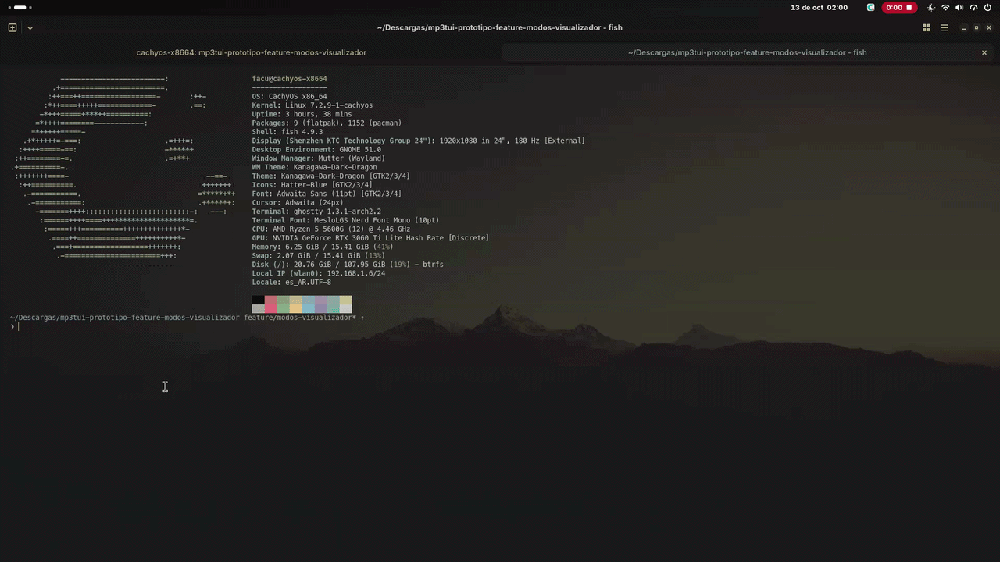
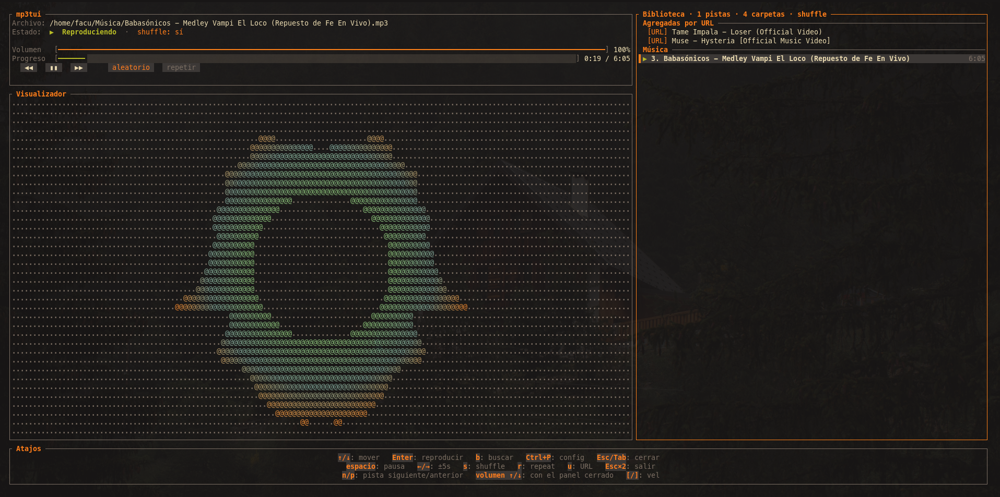
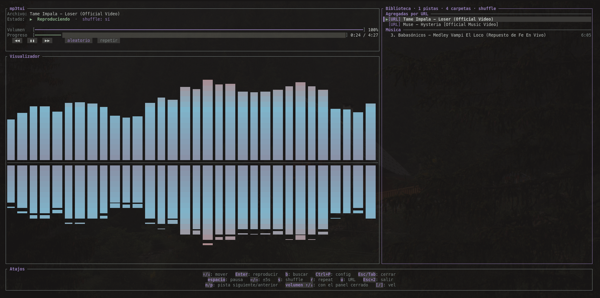
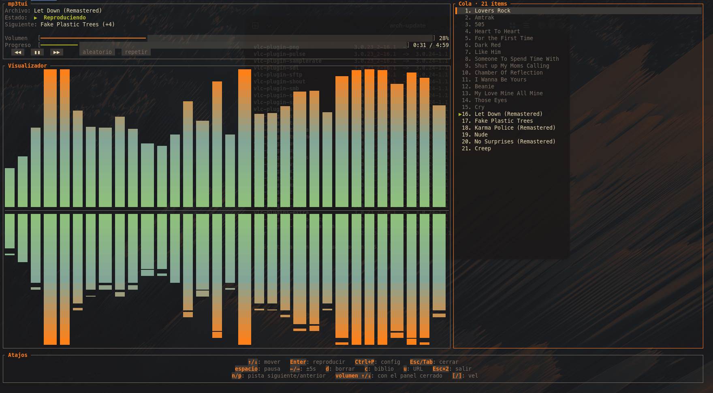

# mp3tui

Reproductor de audio para la terminal, escrito en Rust: reproduce archivos
locales, URLs directas y links de YouTube (vía `yt-dlp`), con una TUI en
[ratatui] con visualizador de espectro en vivo y explorador de biblioteca.
Se maneja por teclado.

[ratatui]: https://github.com/ratatui/ratatui

## Demo

<p align="center">
  
</p>

<p align="center">
  <a href="assets/demo-mp3tui.mp4">▶ Versión en video (mp4)</a>
</p>

<p align="center">
  
  
  
</p>

## Requisitos

- [Rust](https://rustup.rs) (toolchain estable) instalado.
- Un dispositivo de audio disponible.
- `yt-dlp` si querés reproducir links de YouTube.

## Clonar y correr

```sh
git clone https://github.com/facu-bot/mp3tui.git
cd mp3tui

cargo run "cancion.mp3"        # archivo local
cargo run "C:/Musica"          # carpeta con la biblioteca
cargo run "https://www.youtube.com/watch?v=dQw4w9WgXcQ"   # YouTube (requiere yt-dlp)
cargo run                      # biblioteca por defecto
```

## YouTube (yt-dlp)

Para reproducir links de YouTube, mp3tui usa `yt-dlp`. Instalalo según tu
sistema:

- **Windows:** `winget install yt-dlp`
- **Linux / macOS:** el gestor de paquetes de tu distribución o `pip install yt-dlp`

Si no está instalado, la app avisa al intentar reproducir una URL de YouTube.

## Limitaciones y errores comunes

- **Límites de solicitudes a YouTube.** Cada canción se resuelve con una
  llamada a yt-dlp, y YouTube aplica límites de velocidad: si saltás muchas
  canciones en poco tiempo (o usás demasiado el pool con URLs), puede bloquear
  tus solicitudes temporalmente. Esperá unos minutos entre tandas de mala
  suerte.
- **Playlists: un máximo de ~50 canciones es lo recomendable.** El listado es
  barato, pero cada canción se resuelve recién cuando suena (las URLs de audio
  directo vencen), así que una playlist enorme tarda mucho en consumirse y
  sube el riesgo de golpear los límites de arriba. Si te gustan listas muy
  largas, andan, pero no esperes que los 400 primeros temas suenen sin
  saltos.
- **Errores de cookies.** Los videos con restricción de edad (o los que piden
  sesión) pueden fallar porque yt-dlp no pasa cookies de tu navegador. Probá
  primero con yt-dlp manual: `yt-dlp --cookies cookies.txt <url>` (y exportá
  tus cookies con una extensión del navegador). La app no configura cookies
  por sí sola todavía.
- **Error HTTP 403 de yt-dlp.** Es la señal típica de detección de bot o IP
  compartida: YouTube te bloquea por unos minutos. Esperá un rato y volvé a
  intentar; si persiste, probá con cookies (`yt-dlp --cookies cookies.txt`)
  o desde otra red. En la app el error se muestra en la línea de estado del
  reproductor.

## Instalar el ejecutable

Para dejar el comando `mp3tui` disponible en la terminal:

```sh
cargo install --path .
```

### Linux / macOS — PATH

El binario queda en `~/.cargo/bin/mp3tui`. Comprobá que esa carpeta esté en
tu PATH:

```sh
which mp3tui        # o: command -v mp3tui
```

Si no aparece, agregá la carpeta de cargo al PATH en tu `~/.bashrc` (bash) o
`~/.zshrc` (zsh):

```sh
export PATH="$HOME/.cargo/bin:$PATH"
```

Recargá la shell (`source ~/.bashrc`) o abrí una terminal nueva, y ya podés
abrir la app desde cualquier carpeta:

```sh
mp3tui "cancion.mp3"
mp3tui "https://www.youtube.com/watch?v=dQw4w9WgXcQ"
```

### Windows

El ejecutable queda en `%USERPROFILE%\.cargo\bin` (ya incluido en el `PATH`),
así que después podés ejecutar:

```sh
mp3tui "cancion.mp3"
mp3tui "https://www.youtube.com/watch?v=dQw4w9WgXcQ"
```

## Estructura del proyecto

Cada módulo tiene su dominio y sus funciones; la interfaz se divide por
responsabilidad para que sea fácil de mantener.

```
src/
├── main.rs                 # punto de entrada
├── ui/                     # interfaz en terminal
│   ├── mod.rs              #   App, ciclo de eventos y dispatch
│   ├── render.rs           #   dibujado (player, panel, visualizador, barras)
│   ├── queue.rs            #   cola de reproducción y flujos de URL
│   ├── keys.rs             #   atajos, menús y prompt
│   ├── mouse.rs            #   clics y zonas interactivas
│   └── tests_common.rs     #   helpers de los tests
├── source/                 # orígenes de audio
│   ├── http_stream.rs      #   streaming por HTTP con rangos
│   └── ytdlp.rs            #   resolución de links (YouTube, etc.)
├── visualizer/             # analizador de espectro y arte del modo miku
├── audio/                  # motor de audio
├── playlist/               # biblioteca local (escaneo y tags)
├── config.rs               # config.toml, temas y teclas
├── playback.rs             # lógica de reproducción (repeat, shuffle)
├── history.rs              # historial de URLs
└── runtime.rs              # estado activo compartido
```

## Información

Proyecto open source: el código completo vive en este repositorio. Si
encontrás un bug o te falta una función, abrí un issue o mandá un pull
request — las contribuciones son bienvenidas.

## Atajos

| Tecla | Acción |
| --- | --- |
| `espacio` | Reproducir / pausar |
| `↑` / `↓` | Volumen |
| `←` / `→` | Seek ±5 s |
| `n` / `p` | Pista siguiente / anterior (con la Cola cargada, la recorre) |
| `s` / `r` | Aleatorio / repetir |
| `Tab` | Biblioteca (panel lateral) |
| `b` | Buscar |
| `u` | Reproducir una URL (una URL de playlist se lista y encola el resto) |
| `a` | Encolar la pista seleccionada de la Biblioteca |
| `c` | Alternar el panel lateral entre Biblioteca y Cola |
| `d` | Borrar el ítem seleccionado de la Cola |
| `Ctrl+P` | Configuración (temas, bandas, modo) |
| `Esc` `Esc` | Salir |

## Cola de reproducción

Encolá pistas con `a` (Biblioteca) o desde la URL e historial. Los ítems
encolados se ven en el panel lateral con `c`. La cola es una lista con un
**cursor** sobre el ítem que está sonando desde ella: `n` y el fin de pista
avanzan el cursor, `p` retrocede uno y reproduce el anterior. Los ítems no se
consumen al sonar: los ya sonados quedan atenuados en el panel y el ítem parado
en el cursor se marca con `▶`, así siempre se ve a dónde se puede volver. Cuando
no queda nada después del cursor, `n` y el fin de pista vuelven al recorrido
normal de la biblioteca (con `repeat` y shuffle como siempre).

Mientras hay algo después del cursor, el panel del reproductor muestra la
próxima pista (una línea `Siguiente: …` y, si queda más de una, un `(+N)` con
cuántas faltan detrás). Sin nada por delante esa línea no aparece.

### Playlists de YouTube

Si la URL que das (por el prompt `u` o como argumento `mp3tui "URL"`) es una
playlist —tiene `list=` en la query o su path es `/playlist`—, se lista con
`yt-dlp --flat-playlist` (solo títulos, sin bajar audio). La primera canción se
reproduce enseguida y el resto entra a la cola **al final** de la existente;
cada canción se resuelve **recién cuando le toca su turno** (las URLs de audio
directo que devuelve yt-dlp vencen, así que las playlists largas se aguantan
sin romperse). El historial guarda la URL de la playlist cuando suena su
primera canción y la URL de cada canción cuando suena desde la cola.

Si la playlist sale vacía o el listado falla, se muestra un aviso visible y la
cola no se toca.

### Fallo de un ítem encolado

Si una URL encolada no se puede resolver cuando llega su turno (o una pista
local encolada no abre), el ítem se **saltea con un aviso** en la línea de
estado: el cursor avanza al próximo ítem de la cola y lo intenta. Si la cola se
agota, se vuelve al recorrido normal de la biblioteca/historial. El ítem
fallido queda en la cola, atenuado, y el cursor lo pasa.

## Temas y visualizador

Con `Ctrl+P` se abre la configuración (temas, modo y estilo del visualizador).
Los temas se eligen por nombre en `[theme] name` del config.toml (kanagawa-
dragon, tokyonight, catppuccin-mocha, dracula, gruvbox-dark, nord, rose-pine y
**miku**).

El modo **`miku`** (`[visualizer] mode = "miku"`) convierte el visualizador en
la **animación de Miku bailando**: reproduce los frames de la danza (~3 s de
bucle) sobre un fondo de **`@` blancos** como en el archivo original, con la
figura **centrada en el eje X** (el salto al ritmo del bajo mueve a Miku
verticalmente alrededor del centro; el detector de pulso usa las bandas
graves; con silencio o pausa sigue bailando por timer). Los dibujos son
ASCII puro, así que se ve **igual con estilo ascii o unicode**. Elegir el tema
**miku** activa ese modo por default (salvo que `[visualizer] mode` esté
seteado a mano).
